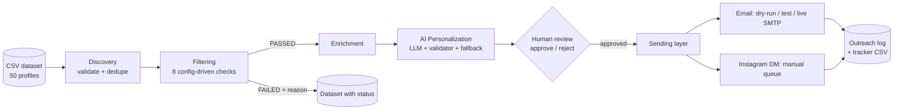

# EDXSO Automated Micro-Influencer Outreach System

An end-to-end, agent-style pipeline that filters and classifies micro-influencers, enriches their profiles, generates personalized outreach (email + Instagram DM) with an LLM, and delivers it through a safe, auditable sending layer.

```
Discovery → Data Collection → Filtering → Enrichment → AI Personalization → Review → Sending → Tracking
```

> **Data notice: no live data is used at this stage.**
> This system runs on a static, pre-collected dataset (`data/influencer_dataset_50.csv`, 50 profiles). It does **not** call Instagram, YouTube, TikTok or any social/scraping API, and it does not fetch fresh metrics or emails at runtime. All follower counts, engagement rates and contact emails are third-party snapshots taken at collection time (see per-row `Metrics Snapshot`, `Email Source` and `Last Verified Date`) and may have changed since. Nothing is scraped, estimated or invented: any value missing from the dataset is written as `Not Found` or `Not Available`. Live discovery is on the roadmap (see [Roadmap](#roadmap)).

---

## Table of contents
1. [Highlights](#highlights)
2. [Architecture](#architecture)
3. [Technology stack](#technology-stack)
4. [Data sources and methodology](#data-sources-and-methodology)
5. [Filtering and classification](#filtering-and-classification)
6. [Profile enrichment](#profile-enrichment)
7. [AI personalization](#ai-personalization)
8. [Sending layer and safety controls](#sending-layer-and-safety-controls)
9. [Results on the supplied dataset](#results-on-the-supplied-dataset)
10. [Setup](#setup)
11. [Usage](#usage)
12. [Configuration](#configuration)
13. [REST API and dashboard](#rest-api-and-dashboard)
14. [Outputs](#outputs)
15. [Project structure](#project-structure)
16. [Testing](#testing)
17. [Limitations](#limitations)
18. [Scalability](#scalability)
19. [Roadmap](#roadmap)

---

## Highlights

- **Grounded, not hallucinated.** Messages are generated only from facts in the dataset, then checked by a validator (length, placeholders, invented numbers, unverifiable "recent post" claims). Failures are retried, then fall back to an offline template.
- **Transparent filtering.** Every profile is marked `PASSED` or `FAILED` with a plain-English reason per check.
- **Safe by default.** Dry-run sending, mandatory human review, test-recipient redirect, duplicate prevention, daily cap, and an auditable outreach log.
- **Honest data handling.** Missing emails are marked `Not Found`; they are never guessed.
- **Provider-agnostic LLM layer.** Gemini or any OpenAI-compatible endpoint (OpenAI, Groq, Together, Ollama), or no LLM at all.
- **Operable three ways.** CLI, FastAPI service, and a built-in review dashboard.
- **Idempotent and resumable.** Re-running a stage never duplicates records or outreach.

## Architecture



All state lives in a local SQLite database (`outputs/outreach.db`); each stage is recorded in `stage_runs`.

## Technology stack

| Layer | Technology |
|---|---|
| Language | Python 3.10+ |
| Storage | SQLite (standard library) |
| API / UI | FastAPI, Uvicorn, vanilla-JS dashboard |
| LLM access | `requests` against Gemini REST or OpenAI-compatible `/chat/completions` |
| Email | `smtplib` over Gmail SMTP (App Password) |
| Config | YAML (`config.yaml`) + `.env` |
| Tests | `unittest` |

| Integration | Required? |
|---|---|
| LLM API key | Optional. With `LLM_PROVIDER=none` the offline template engine is used |
| Gmail SMTP | Optional. Default `SEND_MODE=dry_run` transmits nothing |
| Instagram / Meta API | Not used. DMs are a manual workflow by design |

## Data sources and methodology

The single input is `data/influencer_dataset_50.csv`: 50 profiles (46 Instagram, 4 YouTube) across 9 niches (Fintech, Crypto, Fitness, Beauty, Fashion, Parenting, Gaming, Technology, Lifestyle).

- Each row carries its provenance: `Metrics Source URL`, `Metrics Snapshot`, `Email Source`, `Last Verified Date`, `Notes`. Sources include third-party creator directories (Qoruz, Modash, HypeAuditor) and creator bios.
- For YouTube rows, "followers" means subscribers.
- Of the 50 profiles, 23 fall in the 5K-100K micro-influencer range; 27 are above 100K and are retained so the filter can demonstrate failures with reasons.
- On load, `discovery.py` validates required columns, rejects malformed rows, and drops duplicates by ID and profile URL. Problems are reported, never silently fixed.

## Filtering and classification

Rules live in `config.yaml`. A profile must pass every hard check to be shortlisted.

| # | Check | Rule |
|---|---|---|
| 1 | Platform | Must be in `allowed_platforms` |
| 2 | Follower count | 5,000 to 100,000 (micro-influencer definition) |
| 3 | Category | Niche in `active_categories` |
| 4 | Content relevance | Content themes match niche keywords |
| 5 | Engagement rate | At least `min_engagement_rate` (default 0.2%) |
| 6 | Audience quality | Fake-follower % (parsed from Notes) at most `max_fake_follower_pct`; applied only when data exists |
| 7 | Geography | Optional country allow-list; unknown country is not a failure unless `require_known_country: true` |
| 8 | Brand fit | Excludes editorial / non-individual accounts flagged in Notes |

Contact email is an informational check: a profile without an email can be shortlisted (DM-only) but is never emailed.

**Score (0-100)** = 50 x min(ER/5, 1) + 30 if followers in range + 20 if a valid email exists. Used for ranking only.

**Implemented complete category: Parenting.** Run any niche or combination, for example:

```bash
python main.py run --categories Fashion,Beauty
```

## Profile enrichment

Each shortlisted influencer receives a record containing: name, handle, platform, profile URL, followers and tier, engagement rate, niche, content themes, contact email with type (personal or business domain), caution flag and source, Instagram/YouTube/TikTok URLs, creator country, and source metadata.

Fields not present in the dataset (website, audience age, audience gender) are written as `Not Available`. Audience geography is limited to the creator country.

## AI personalization

For each shortlisted influencer the system produces:

- **Email pitch:** 60-90 words (body only; greeting, signature and opt-out line are added by code).
- **Instagram DM:** 15-30 words.

Pipeline: facts from the enriched record, then LLM, then validator, then up to 3 retries with the error list fed back, then offline template fallback.

The validator enforces: word limits, no placeholders, no numbers absent from the facts, no unverifiable wording ("recent", "latest", "just posted", ...), company named in both messages, sender named in the DM, and at least one niche or theme signal. The result is stored with each message (`generator`, `validation`).

**Why no "recent post" references?** The dataset contains content themes, not individual posts. The system therefore refuses to claim it saw specific or recent content.

No model name is hard-coded; set `LLM_MODEL` yourself. The system prompt lives in `outreach/personalization.py` (`SYSTEM_PROMPT`).

## Sending layer and safety controls

| Control | Behavior |
|---|---|
| Review gate | Nothing is sent unless a message is **approved** (CLI or dashboard) |
| `SEND_MODE=dry_run` (default) | Logs `SIMULATED`; transmits nothing |
| `SEND_MODE=live` + `TEST_RECIPIENT` | Every email is redirected to you and logged `TEST_SENT` |
| `SEND_MODE=live` only | Real sending via Gmail SMTP |
| Duplicate prevention | One real send per influencer and per email address |
| Missing email | Skipped and logged `SKIPPED_NO_EMAIL`; falls back to manual DM |
| Caution emails | Agency / editorial / unconfirmed addresses are blocked by default |
| Daily cap and delay | `sending.daily_cap`, `sending.delay_seconds` |
| Instagram DMs | Never automated; manual queue plus "mark sent" |
| Opt-out line | Included in every email footer |

Every action is written to the `outreach_log` table and exported to `outputs/outreach_tracker.csv`.

## Results on the supplied dataset

Default run (category: Parenting, offline template mode, dry-run send):

| Metric | Value |
|---|---|
| Profiles loaded | 50 |
| Parenting profiles | 6 |
| Passed filters | 4 |
| Failed (with reason) | 46 overall (e.g. 71.57% fake followers; ER 0.05% below minimum; above 100K followers) |
| Shortlisted with a public email | 2 |
| Shortlisted without email (DM only) | 2 |
| Messages generated | 4 (email + DM each) |

Sample files are included in `outputs/`. They were produced by an offline demonstration run (template mode, auto-approved, dry-run) to show the output formats.

## Setup

Requirements: Python 3.10+ and Git.

```bash
git clone https://github.com/Avinashhh06/Edxso-outreach-agent.git
cd Edxso-outreach-agent

python -m venv .venv
# Windows PowerShell
.venv\Scripts\activate
# macOS / Linux
source .venv/bin/activate

pip install -r requirements.txt
cp .env.example .env        # Windows: copy .env.example .env
python main.py doctor       # shows what is configured and what is missing
```

Optional guided configuration (prompts for keys, writes `.env`):

```bash
python main.py setup
```

**Gmail App Password** (only for live sending): enable 2-Step Verification, then create one at `myaccount.google.com/apppasswords` and set it as `SMTP_APP_PASSWORD`. `FROM_EMAIL` should match the authenticated Gmail account unless a "Send mail as" alias is verified.

## Usage

```bash
python main.py run                      # discovery to personalization, stops at review
python main.py review                   # read all generated messages
python main.py review --approve-all     # or: --approve INF_036 INF_039  /  --reject INF_037
python main.py send                     # dry-run unless SEND_MODE=live
python main.py dm                       # manual Instagram DM queue
python main.py dm --mark-sent INF_036   # record a manually sent DM
python main.py export                   # regenerate output files
python main.py status                   # counts at a glance
python main.py serve                    # API + dashboard on http://127.0.0.1:8000
python main.py reset --yes              # delete the local database
```

Useful flags for `run`: `--categories`, `--auto-approve` (skips review; not recommended), `--send`, `--force-messages`.

**Recommended first live test:** set `SEND_MODE=live` and `TEST_RECIPIENT=<your own email>`, approve one message, run `python main.py send`, and confirm the email arrives in your own inbox before removing `TEST_RECIPIENT`.

## Configuration

`config.yaml` holds all business rules; `.env` holds secrets.

| Setting | Where | Purpose |
|---|---|---|
| `company`, `campaign` | `config.yaml` | Sender identity, collaboration angle, value proposition, CTA, opt-out line |
| `filters.*` | `config.yaml` | Categories, follower range, minimum engagement, fake-follower cap, countries |
| `category_keywords` | `config.yaml` | Content-relevance keywords per niche |
| `personalization.*` | `config.yaml` | Word limits and retry count |
| `sending.*` | `config.yaml` | Daily cap, delay, caution-email blocking |
| `LLM_PROVIDER`, `LLM_MODEL`, `LLM_API_KEY`, `LLM_BASE_URL` | `.env` | LLM access (`gemini`, `openai_compatible`, or `none`) |
| `SEND_MODE`, `SMTP_*`, `FROM_EMAIL`, `TEST_RECIPIENT` | `.env` | Sending layer |

## REST API and dashboard

Start with `python main.py serve`. Dashboard: `http://127.0.0.1:8000`, interactive API docs: `/docs`.

| Method | Endpoint | Description |
|---|---|---|
| GET | `/api/health` | Service and mode info |
| GET | `/api/status` | Pipeline counts |
| GET | `/api/influencers` | All profiles with status and reason |
| GET | `/api/shortlist` | Enriched shortlist |
| GET | `/api/messages` | Generated messages and review state |
| POST | `/api/messages/{id}/review` | Approve / reject / reset a message |
| POST | `/api/pipeline/run` | Run the pipeline |
| POST | `/api/send` | Send or simulate approved emails |
| GET | `/api/outreach` | Raw outreach log |
| GET | `/api/tracker` | Outreach tracker view |
| GET | `/api/dm-queue` | Manual DM queue |
| POST | `/api/dm/{id}/mark-sent` | Record a manual DM |

The API has no authentication and is intended for local use. Do not expose it publicly as is.

## Outputs

Generated in `outputs/`:

| File | Content |
|---|---|
| `influencer_dataset_with_status.csv` | All 50 profiles with PASSED/FAILED, reason, score |
| `filter_report.csv` | Per-check pass/fail detail |
| `enriched_shortlist.csv` / `.json` | Enriched profiles |
| `personalized_messages.csv` / `.md` | Email and DM for each shortlisted profile |
| `outreach_tracker.csv` | Influencer, email, message generated, sent, date, status |
| `dm_manual_queue.csv` | DMs to send manually |
| `outreach.db` | SQLite database (not committed) |

## Project structure

```
.
├── main.py                  # CLI entry point
├── config.yaml              # business rules
├── .env.example             # secrets template
├── requirements.txt
├── data/
│   └── influencer_dataset_50.csv
├── outreach/
│   ├── cli.py               # commands: setup, doctor, run, review, send, dm, serve ...
│   ├── pipeline.py          # stage orchestrator
│   ├── discovery.py         # CSV validation and loading
│   ├── filtering.py         # checks, scoring, classification
│   ├── enrichment.py        # profile enrichment
│   ├── personalization.py   # prompt, validator, template fallback
│   ├── llm.py               # Gemini / OpenAI-compatible client
│   ├── sender.py            # review gate, SMTP, dedupe, DM queue
│   ├── exports.py           # CSV / JSON / Markdown deliverables
│   ├── api.py               # FastAPI app
│   ├── db.py, config.py, utils.py
│   └── static/dashboard.html
├── tests/
└── outputs/
```

## Testing

```bash
python -m unittest discover -s tests -v
```

The suite covers CSV loading, filter rules (follower range, fake-follower flag, category override), enrichment honesty (no invented emails or audience data), message validation across all 50 rows and many template variants, LLM failure fallback, review gating, dry-run, test-recipient redirect, duplicate prevention, and the manual DM queue. LLM and SMTP calls are mocked. API tests run only when FastAPI and httpx are installed.

## Limitations

- **No live data.** All metrics and emails are static snapshots from the dataset and may be outdated. Emails are taken from public bios and third-party pages and are not verified as deliverable.
- **Limited reach in the demo category.** Only 2 of the 4 shortlisted Parenting profiles have a public email; the other 2 are reachable only by manual DM.
- **No post-level personalization.** The dataset has content themes, not individual posts.
- **Missing fields.** Website, audience age and audience gender are not in the dataset.
- **Engagement attribution.** Engagement rates come from third-party sources; some Notes flag ambiguous attribution.
- **No Instagram DM automation**, by design and to respect platform rules.
- **Live credentials are yours to verify.** LLM and SMTP paths are unit-tested with mocks; run a first live test with `TEST_RECIPIENT` before real outreach.
- **Local-only API.** No authentication layer.

## Scalability

Stages are idempotent and keyed by `influencer_id`; filtering is linear and driven by config. To move from 50 to 500+ influencers: replace `discovery.py` with an ingester that implements the same `store()` interface, move SQLite to Postgres by swapping `db.py`, and run LLM calls and sending through a queue worker.

## Roadmap

- Live discovery through permitted platform and directory APIs, with refresh of follower and engagement metrics.
- Email verification step before sending.
- Post-level personalization once recent-content data is available from a compliant source.
- Reply tracking and follow-up sequences.
- Authentication for the API and dashboard.
- n8n / Make workflow export.

## License and responsible use

Use this tool only to contact creators who have published a business contact address, honor opt-out requests, and comply with applicable email and platform regulations (for example CAN-SPAM, GDPR, and Instagram's terms).
